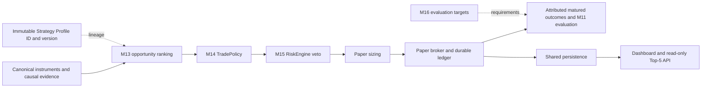
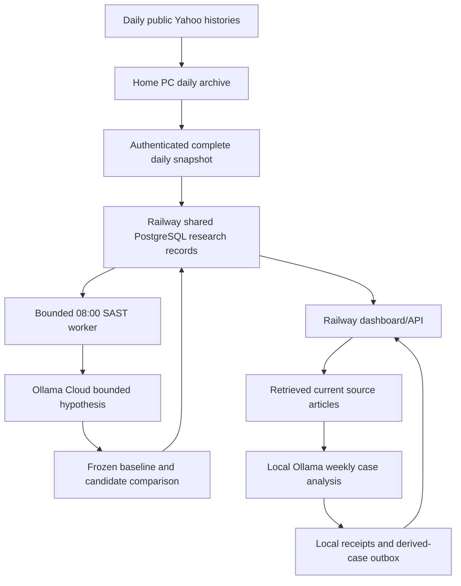

## X1b pure legacy scorer — 20 October 2026, for owner review

Shared core 0.2.0 adds `legacy-news-v1`: pure keyword/mention scoring and
normalization of caller-supplied assessments, with immutable provenance and
pinned original/hand-answer parity fixtures. The execution analyzer remains
unchanged; nothing imports the package at runtime. X1a contract schemas/IDs,
R12 issuer guards, source weights and strategy defaults are unchanged. R12 is
still the sole ACTIVE/PARTIAL milestone. See [ADR0072](../adr/0072-pure-legacy-news-scorer.md)
and [checkpoint](../changes/X1B_PURE_LEGACY_NEWS_2026_10_20.md).

## Operational Sasol paired refinement — 20 October 2026

The fixed baseline/candidate numerical shadow loop is implemented and active on real local source data. One change only: relative-volume threshold>1.2 versus>1.0; other1.1/1.2 rules fixed,3-observed-session horizon. The existing five-minute clock records controls, paired outcomes and comparative reviews. Native:1episode, bothNO_SETUP,0/20informative pairs; no further software prerequisite to collecting this experiment. Source dates/actual receipts, whole feature dependencies, executable hashes and revision exclusions are frozen; independent source/time and integration reviews passed.1355safe tests/54protected checks pass; dashboard verified. This is sampled-path exploratory numerical research with assumed costs, no model training, promotion or Live execution. R12 remains the sole ACTIVE/PARTIAL milestone for broader news/historical/execution evidence. See [operating record](../research/SASOL_PAIRED_REFINEMENT_2026_10_20.md) and ADR0070. Earlier checkpoints below remain historical.

## Evidence-bound learning coordinator — 20 October 2026

R12 remains the sole ACTIVE/PARTIAL milestone. The existing light clock now records idempotent weekly/evidence-triggered training reviews and source-linked lesson memory, with separate news/Swing acceptance checks. Heldout labels do not enter adaptive memory; prior lessons cannot become news citations. The older Swing validator now enforces one changed parameter. Native PostgreSQL shows1review/0lessons/0adjudicated targets, correctly WAITING. The21–28October frozen protocol and four acquisition attempts remain unchanged. A calibrated Qwen actual-source trial is queued behind10-minute idle/3.5GiB gates; production llama3 remains unchanged.1330safe tests/54protected checks pass. No executable candidate, learned weights, source unpause or trading promotion is claimed. See [operating record](../research/HERMES_COORDINATOR_2026_10_20.md) and ADR0069.

## Research software continuation — 20 October 2026

The existing paper-record repository now stores immutable calendar as-of references, prospective source endpoints, close-only benchmark outcomes and revision overlays. The light calendar clock runs deterministic scoring without retrieval/model/trading work. New protected news-plan/review/adjudication actions and read-only status extend the existing weekly research API; Market AI / News provides blinded review controls. Protocol/guard/corpus hashes bind a future evaluation to its preregistration. Human assertions and AI suggestions remain separate; source pause and zero weights persist.

Whole-source IRESS routing accepts registered cash-share candidates with exact lineage while preserving canonical OST. An explicit duplicate-only transformation archives native/derived bytes and survives v3 normalization/ingest. The current configured universe remains Sasol-only. A separate bounded small-model calibration passed one synthetic generation; the hourly production profile is unchanged. See [ADR0068](../adr/0068-prospective-reviews-and-calendar-price-outcomes.md) and [native operating evidence](../research/PROSPECTIVE_LEARNING_COMPLETION_2026_10_20.md).

## Cited expectations and daily import routine — 19 October 2026

R12 remains the sole ACTIVE/PARTIAL milestone. Source-bound local Ollama draft preparation, strict citation/issuer/numerical checks and explicit operator freeze are implemented; outcome scoring and learned weights remain pending. The hourly idle task is enabled with two CPU threads, owned-process cancellation and a 7 GiB free-RAM start gate. Current free RAM is about 4 GiB: actual inference is waiting, with zero new model calls. A weekday08:00SAST internal-calendar routine and persistent red import button provide a copyable broker-login/capture prompt. Published Top5 changes queue source/evidence requests and preserve prior candidates; the actual fresh universe is still Sasol-only, the ranking is stale, and eight pilot/context requests exist. Five-share price-row planning is1.92MB, distinct from109MB runtime/4.66GB models and raw/news/backup growth. Browser/API/native clock verification, 1207 safe tests and 54 protected artifacts pass. Existing weekly source pause was restored after an earlier explicit source-toggle POST; source writes now require operator authority and strict boolean input. No B5/AI/execution promotion. See [operating record](../research/SOURCED_EXPECTATIONS_AND_DAILY_IMPORTS.md) and ADR0067.

## Internal early-warning calendar and news testing — 19 October 2026

R12 remains ACTIVE/PARTIAL. Market AI / News now shows a source-bound research calendar with separately confirmed dates, optional frozen expectations and append-only warning/acknowledgement records. The light local five-minute clock runs while signed in, without model/provider/paper calls; heavy work retains idle gating. Three official date-only events are installed: Sasol quarterly22Oct, AGM13Nov and SARB19Nov. Actual sources/receipts, native PostgreSQL restart/idempotence and Windows taskresult0 are verified. A late seven-day Sasol window is marked missed. Fresh public-feed capture retains25articles, expanding the biased review corpus to27articles/486pairs, still0labels/noholdout/learnedweights.147focused/1115fullsafe/54protected checks pass; browser verified. Next is the prospective prediction/trigger/outcome radar, not yet an active news-to-price learning loop. Weekly source remains paused; B5/AI/execution gates unchanged. See [calendar operating and next-learning record](../research/RESEARCH_EARLY_WARNING_CALENDAR.md) and ADR0066.

## Local Hermes evidence foundation — 16 October 2026

R12 remains the sole ACTIVE/PARTIAL milestone. The owner-requested local Hermes first slice now has durable scientific experiment storage, a hash-bound retained-excerpt review corpus, blinded human label queue/import, descriptive frozen-guard evaluation and a read-only dashboard summary. Native PostgreSQL restart/idempotence/exclusive-lock proof passes. Actual first run: two retained articles, 36 article/share examples, zero reviewed labels, one DRAFT experiment; INCONCLUSIVE, no learned weights or model calls. Future weekly ingress preserves bounded normalized supplied articles including zero-case scans; legacy missing denominators stay explicit. Full safe suite:1058 pass; final focused suite:91 pass;54 protected checks pass. No source unpause, new supervisor schedule, B5/historical AI admission or execution change. Next: prospective denominator, independent adjudicated labels and grouped chronological holdout before evaluating a candidate or scheduling either Hermes supervisor. See [local Hermes operating record](../research/LOCAL_HERMES_FOUNDATION.md) and ADR0065.

## X1a shared contract boundary — 20 October 2026, for owner review

`packages/jse_intelligence_core` is an installable Python 0.1.0 distribution with
no runtime dependencies or application imports. Immutable SectorScope,
EvidenceReference and RadarReleaseManifest v1 records define explicit product
scope, provenance/time uncertainty and inert release identities/compatibility.
No runtime imports it; scoring, strategy, provider/database configuration and
activation remain unchanged. This is a bounded continuation of sole
ACTIVE/PARTIAL R12. See [ADR0071](../adr/0071-shared-intelligence-contract-boundary.md)
and [schema/API](../../packages/jse_intelligence_core/README.md). X1b scorer
characterization/extraction is proposed only, pending owner review.

# Current architecture — local placement override, 15 October 2026

The new owner-authorized local lineage uses one isolated PostgreSQL18 cluster on loopback55432 for dashboard and paper worker. Private acceptance requires the matching database/account, LOCAL/LOCAL_UPLOAD and explicit provider/model disable switches. Windows worker/backup tasks require10minutesidle; interactive news inference has zero budget. Railway web/worker source connections and cron are removed; original inactive volume retained. No hosted ledger was restored. See [local operating guide](../research/LOCAL_PC_OPERATING_GUIDE.md). Earlier cloud diagrams below are historical checkpoints.

Use [current state](../CURRENT_STATE.md) for the operating snapshot and [target architecture](TARGET_ARCHITECTURE.md) for work not yet implemented. Earlier accumulated milestone notes are preserved in [the checkpoint archive](../history/CURRENT_ARCHITECTURE_PRE_2026-10-05.md).

## Canonical decision path

Relevant code lives in `application/opportunities/`, `domain/evaluation/`, `domain/policy/`, `domain/risk/`, `domain/strategy/`, `domain/broker/` and `persistence/`. `app.py` composes Flask/SocketIO and API blueprints. Default Top-5 reads committed worker state when the paper loop is configured; a web refresh is not another trading cycle.

M13–M16 contracts are preserved. Registry references carry both `strategy_profile_id` and `strategy_profile_version`; selecting a card does not activate another decision engine. No broad strategy-column migration was added: compatible immutable records carry exact lineage, and old records stay unattributed. See [strategy profiles](../research/STRATEGY_PROFILES.md).

## Research lanes

R2's `/api/v1/learning/overview` exposes a bounded aggregate projection of existing frozen Swing decisions, 3/4/5-session labels, controls and AI sample counts. Runtime/database ownership is explicit. A configured local dashboard reads the pinned Railway public status endpoints without credentials or account fields; hosted services read their own repository. The relocated Windows collector uses the main checkout with preserved ignored receipts/configuration. No rules, database ownership or worker schedules changed. See [daily learning connection](../research/DAILY_LEARNING_CONNECTION.md) and ADR 0052.

The local backtest evidence panel in Trading Strategies reads a fixed, bounded `dashboard-summary.json` through GET `/api/v1/local-backtest/research-summary`. `LOCAL_BACKTEST_REPORT_DIR` configures its directory; absence or invalid content produces an explicit unavailable state. The offline exporter admits only the owner-approved B5 partial-close projection and matching conditional reference/comparison. Refresh does not execute replay or provider calls. B5 real-data admission remains false, and IG access is separately unverified. See [R1 operating interface](../research/LOCAL_BACKTEST_RESEARCH_INTEGRATION.md) and ADR 0051.

Swing 1.0.1 remains canonical. Separate 1.1.0 technical shadow, 1.2.0 cash LONG daily policy replay, and 1.3.0 AI hypothesis comparisons keep independent attribution. The policy uses an observable later close, fixed structure/ATR stop and entry-based 2R target, conservative ambiguous-bar handling, 3/4/5 observed-session exits and hypothetical costs. It grants no M15 approval.

Cloud hypothesis proposals are immutable and drawn from a bounded parameter family. Training precedes the holdout, with a purge; repeated holdout use is explicitly ineligible for automatic promotion. Daily attempt reservation and stored proposals prevent retries from spending another cloud model call. These are historical experiments, not a trained LLM or validated execution strategy.

Local weekly-news analysis stores briefs, source-linked cases, receipts and delivery outboxes. Distinct publishers and duplicate controls gate the small research attention boost. Only already FLAGGED historical cases qualify for the local descriptive screen; actual receipt time determines availability. See [weekly news research](../research/WEEKLY_NEWS_RESEARCH.md).

## Physical placement

The actual uploader sends all configured histories; selective radar packets are a future design. `SWING_DATA_SOURCE=LOCAL_UPLOAD` gates the cloud paper-input path. On-demand quotes/charts and news feed reads remain separate. Windows collection at 07:30 SAST precedes Railway's `0 6 * * *` scheduled worker at 08:00 SAST; the worker exits after its work. PostgreSQL is durable, shared and does not fall back to local SQLite on failure.

Existing append-only ledger boundaries store the new research records; migrations for prior paper/shadow features remain explicit and additive. Startup never performs a production migration. Secrets remain private local/hosted configuration; dataset bodies and raw model outputs remain ignored runtime data.

## Presentation and safety

Six dashboard sections expose separate paper, strategy, canonical ranking, news, technical and system states. Printable worksheets and a manual Demo journal are available behind existing operator controls. Connected IG cash keeps account/currency provenance separate from simulator cash; journal records are self-reported.

Read-only IG authentication/discovery is working, while tested JSE history is entitlement-blocked. Alpha Vantage repair logic exists but verified JSE coverage is unresolved and scheduled calls are disabled. Estimated display bars never become trade evidence. Intraday CFD and long-term cards remain truthful placeholders. Legacy multi-agent/60–30–10 benchmark code remains preserved without reconnecting it to canonical ranking. Broker Live execution remains disabled; Demo mutations require their own existing safety gates and authorization.

The architecture's current limiting factor is admissible evidence, not proof of an AI edge: cloud replay has zero closed holdout samples and the first weekly-news scan has zero corroborated flags.

Local research addition: isolated domain/backtest core and frozen-policy bridge; no runtime wiring. See docs/research/LOCAL_BACKTEST_IMPLEMENTATION.md for scoped acceptance.

Historical SENS research extends the existing fetcher/evidence normalization with bounded ShareData/Moneyweb/Sharenet parsers and an optional event context sidecar. Actual receipt governs availability; source copies are one disclosure origin. No running collector or trade behavior is rewired. See [historic SENS pilot](../research/LOCAL_SENS_HISTORY.md) and ADR 0048.

Local implementation navigation: [operating interface](../research/LOCAL_BACKTEST_OPERATING_GUIDE.md), [B1–B5 evidence and gates](../research/LOCAL_BACKTEST_IMPLEMENTATION.md). B1–B4 are implemented in an isolated local lane; B5 real-data acceptance is blocked. The architecture's running services and safety boundaries are unchanged.

The isolated replay now supports opt-in directional OST cash-share cost sensitivity through `domain.backtest.costs.OSTCashShareCosts`, reusing the existing published component diagnostic. It includes purchase-only tax and fees during sizing, and rejects non-ZAR/non-equity manifests. This does not wire a broker or change canonical costs. Official pilot daily sessions are now verified; action, intraday volume/interval and execution evidence still block B5 acceptance. See ADR 0049 and the [continuation record](../research/LOCAL_BACKTEST_B5_CONTINUATION.md).

6 October R3: offline readiness command reuses completion/OHLC validation and recovers a separate hashed IRESS Sasol series. It does not feed or mutate cloud datasets, frozen decisions or admission. See ADR 0053 and DATA_READINESS_AUDIT.md.

R3 continuation captures OST STX40 HLCV and uses completed closes for an offline benchmark comparison. Missing opens and inconsistent HLC stay explicit. Numeric Sasol coverage is complete in the separate paired diagnostic; cloud inputs and admission gates are unchanged.

R4 integrates provenance-preserving supplemental IRESS Sasol and OST STX40 charts through dataset v2 for prospective shadow research only. Canonical Yahoo inputs, historical AI evaluation, worker schedule and B5 gates remain intact. See ADR 0054 and SUPPLEMENTAL_RESEARCH_INTEGRATION.md.

## R4 deployed state, 6 October 2026

The v2 supplemental research lane is installed in local and hosted runtimes, with durable source receipts in Railway PostgreSQL. The API reports current Sasol inputs AVAILABLE while preserving the separate last frozen worker snapshot and genuine pending labels. The canonical Yahoo lane and historical AI evaluation remain unchanged. The local Windows launcher supports a hidden persistent background process. Final web deployment 8c0d6f26-26a3-40bf-a802-8fdf9f74c5af and worker deployment c7a6ffee-5a94-4cba-8b3a-c71d2752414e are successful; public health and overview endpoints return HTTP 200. B5 source semantics/admission remain deferred.

## R5 OST primary research path

Dataset v3 carries whole-source OST HLCV charts and explicit source receipts for registered cash shares and sector ETFs. A local-only import route and credential-free batch CLI save ignored runtime copies; the existing collector performs authenticated cloud upload. UploadedFetcher and on-demand JSE research use fresh OST charts without Yahoo fallback after v3 activation. Hosted import is disabled. The dashboard reports per-instrument coverage and source expiry. Missing opening prices and invalid HLC remain visible. Historical AI comparison is gated while source semantics are unverified. Older v1/v2 datasets and frozen records remain readable. Gold and USD/ZAR reference charts are outside the OST equity contract. See ADR 0055 and the [onboarding guide](../research/OST_PRIMARY_ONBOARDING.md).

OST's native Save To Excel control delivers an HTML price-history grid with an `.xls` name. The same local importer reads that grid or a CSV, retains the raw-file hash and exact capture time, and admits only the latest 600 completed sessions per instrument. Six real exports are present locally and in Railway, including all three sector ETFs and Naspers as a non-Sasol share. The sign-in/session belongs to the owner; scheduled collection republishes installed fresh exports but cannot renew expired evidence or operate an unattended broker login.

## R6 local multi-source resolution

`source_resolution` audits alternative whole-source IRESS histories, the archived pre-cutover Yahoo charts and provider access routes for every registered stock. Local dashboard status computes the plan on refresh; the daily collector saves the same audit before uploading its unchanged OST v3 snapshot. Exact instrument identity, complete OHLCV, raw-file hash, capture receipt, source freshness and OST close overlap are checked before an IRESS history is labelled a candidate. ShareData and JSE remain contract/access leads, not configured data feeds. No source field is copied into an OST bar, and the source-resolution audit is not uploaded to Railway or used for paper decisions. See ADR 0056 and [operating record](../research/MULTI_SOURCE_PRICE_RESOLUTION.md).

## R11 separate IRESS numerical path, 8 October 2026

The OST v3 collector may now carry one optional full `research_charts.SASOL` IRESS history derived from hash-matched raw archive at its original acquisition time. Normalization preserves and validates it. Canonical `get_chart` remains OST; research selection supplies the complete IRESS chart to technical shadow calculations and retains the OST close benchmark. Hosted audits derive exact integer-cent/whole-unit comparisons from these two charts without a second store. Receipt expiry, missing benchmarks and immutable same-source label rules remain enforced. Historical AI still stops before its model for v3; B5/execution gates are intact. See ADR 0061 and [R11 evidence](../research/IRESS_OPEN_ROUTING_R11.md).
