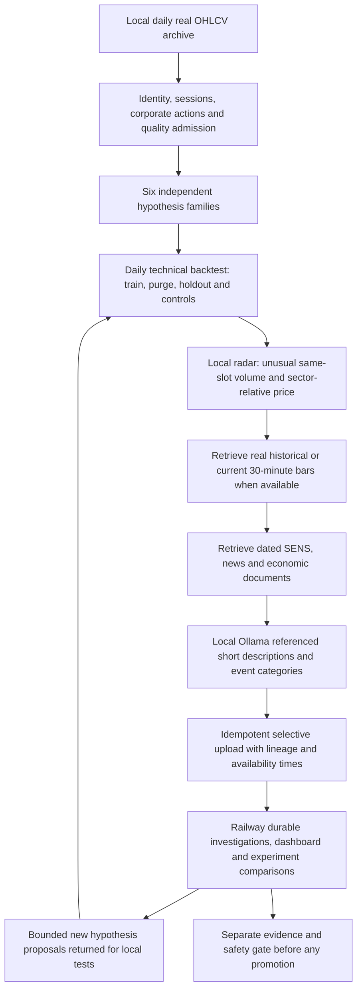

## First real screening reviewed — 27 October 2026

The owner-approved one-call real packet returned 0/8 matches despite the 8/8
narrow event checks. A source assessment frozen before generation disagrees;
it is explicitly assistant review, not human ground truth or training labels.
The exact broad request/model is held pending correction; source collection,
calendar clocks and source leads continue. Source intake now excludes stale
headlines from current watches without deleting research history, reuses known
calendar references without duplicate watches, and checks each news item separately.
1,533 offline / 74 focused / 5 private spender tests and 54 protected checks pass.
The one extra call and all earlier budgets/receipts are preserved. A historical
Sasol calendar date discrepancy is flagged without rewriting frozen evidence.
R12 stays sole ACTIVE/PARTIAL; P1 open. Next: the proposed four-call request/width
comparison; no further inference is queued. See
`docs/changes/2026-10-27-first-real-screen-review.md` and ADR0081.

## Qwen relevance correction verified — 27 October 2026

The explicit boolean protocol passes all eight frozen native source-relevance
checks, including unrelated issuer, wrong event, unsupported facts and reversed
candidate order. Exactly eight newly approved foreground calls were used; the
same batch resumes after a memory wait and cannot make a ninth call. Earlier
six attempts and today's spent discovery slot remain. No model weights or
trading defaults changed. 1,526 full offline tests, 67 focused tests and 54
protected checks pass. The live local dashboard shows 8/8 checks, two confirmed
calendar events and eight source leads. Narrow relevance qualification is
established; broad news accuracy, forecasts and P1 acceptance remain open.
R12 stays sole ACTIVE/PARTIAL. See
`docs/changes/2026-10-27-qwen-boolean-relevance.md` and ADR0080.

## Source radar restored; Qwen selection unqualified — 27 October 2026

Confirmed calendar dates and recent retained source leads now appear independently
of failed model extraction. Native verification completed exactly four approved
foreground calls: one selection pass, two abstention failures, one private real
packet diagnostic. No model watch or qualification was published; both historical
failures remain. A repeat invocation makes no fifth call. Routine ten-minute
idle, two CPU threads and memory limits remain unchanged. Two sourced calendar
events and eight news leads are visible; 1,519 offline tests and 54 protected
checks pass. The Sasol paired definition remains intact. R12 stays the sole
ACTIVE/PARTIAL milestone; P1 remains open. See
`docs/changes/2026-10-27-host-grounded-radar.md` and ADR0079.

## Anticipatory radar implementation update — 27 October 2026

The advisory calendar/news radar slice is implemented separately from financial
strategy qualification. See ../research/ANTICIPATORY_RADAR.md. Recurring public
capture, cited candidates, sector-topic navigation, 48h/24h packets and the UI are
installed. Real-source small-model qualification and prospective observed quality
remain pending; neither model weights nor trading defaults changed.

# Target architecture — local research and selective cloud memory

This document is a proposal for the next phase, not a description of implemented capabilities. Compare with [current architecture](CURRENT_ARCHITECTURE.md), [current state](../CURRENT_STATE.md), and [six swing hypotheses](../research/SIX_SWING_HYPOTHESES.md). Original target plans remain in [the dated archive](../history/TARGET_ARCHITECTURE_PRE_2026-10-05.md).

The [rule refinement 0.2](../research/SWING_RULE_REFINEMENT.md) defines bounded entry/trailing/exit comparisons, separate volume activity/evidence/risk contracts, pooled sector/share personalities and nested causal tests. South African studies motivate experiments but establish no per-sector 3–5-session indicator winner.

The owner's objective is adaptive 3–5-session strategy research: retain raw data and calculate technical evidence locally, detect unusual volume and sector-relative movement, retrieve dated news/SENS/economic context, then persist meaningful investigations and comparisons on Railway. AI proposes and categorizes; causal backtests, costs, controls and risk gates determine what survives.

The owner has now prioritised the [local backtest engine contract](../research/LOCAL_BACKTEST_ENGINE_SPEC.md) before the wider rollout. Gates B1–B5 establish deterministic replay, accounting, independent FX/gold adapters and chronological indicator selection. The [feedback loop](../research/ADAPTIVE_SWING_FEEDBACK_LOOP.md) explicitly reconsiders adding/replacing/removing indicators, with separate hypothesis tests. These are documented proposals, not installed capabilities. See [ADR 0046](../adr/0046-backtest-engine-before-adaptive-loop.md).

## Contracts to establish first

Freeze each hypothesis ID/version, dated universe membership, instrument/vehicle identity, actual price/volume basis, sector/commodity/FX benchmark, entry/exit rules and allowed modes. Keep training inputs separate from future labels, and record receipt, publication and tradable availability independently. Store denominator/control summaries for untriggered days locally so radar-selected cases do not become a biased backtest.

Equity radar draft thresholds are 1.5× the same 30-minute slot's prior-20-session volume and approximately 1.5 standardized units of sector-relative movement. They need validation; no such radar is currently enabled. FX/gold need separate verified volume contracts; spot/tick proxies cannot impersonate JSE traded shares. Never synthesize 30-minute bars from daily OHLC.

Event retrieval must precede Ollama interpretation. Record evidence as VERIFIED_BEFORE_ENTRY, POST_MOVE_EXPLANATION, PUBLISH_TIME_UNKNOWN or NO_VERIFIED_EVENT_FOUND. Later explanations cannot become earlier entry signals. Preserve source IDs, timestamps and uncertainty rather than inventing a catalyst. Weekly briefs are leads, with research-only priority, not a second confirming source.

## Placement and evolution

Extend the existing registry, causal feature/evaluation infrastructure, paper ledger, news catalog and outboxes. Start by aligning the six-family contracts and real-data admission, then implement local daily backtests, optional intraday refinement, dated event retrieval and selective upload in dependency order. Do not start all six as separate unconstrained bots.

Current daily archives/uploads and the cloud 1.3.0 comparison loop are reusable foundations. They do not yet supply the complete local engine or adaptive event taxonomy. Parameter evaluation and event memory are distinct from LLM weight fine-tuning. An always-available web/database service can retain state while bounded workers run on schedule; continuous CPU inference is not required for a 3–5-day strategy.

No automatic promotion, Live broker execution, ranking-weight changes, or legacy multi-agent reconnection belongs to this target without a separate milestone and evidence. Prospective walk-forward acceptance, sufficient independent outcomes, actual costs/liquidity and M15 veto remain required.

Implementation update: B1–B4 are implemented locally; B5 software/audit work is delivered with unresolved real-data acceptance. The wider target flow above remains proposed. See [operating guide](../research/LOCAL_BACKTEST_OPERATING_GUIDE.md).
